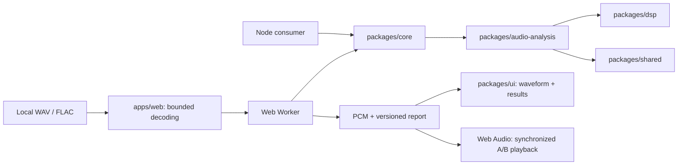
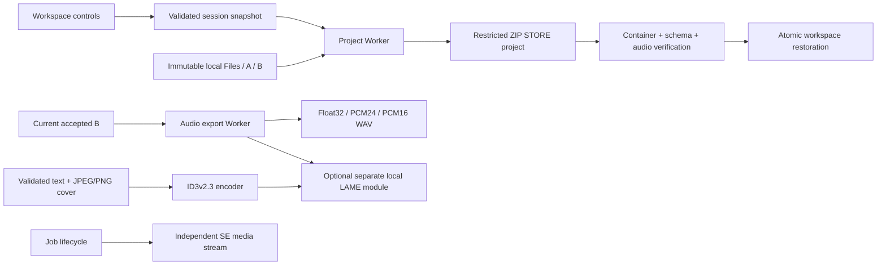

# Architecture

The shared `core/stem-restoration.ts` prepares accepted per-material grain and
treble repair for both file-STEM mixing and individual preview. The Web's
`stem-repair-render.ts` is a File/chunk/output adapter in the processing Worker.
`stem-repair-preview.ts` owns one leased candidate, abort handling and FLAC
coordination; `stem-solo.ts` owns playback and matched monitoring.
Per-material `restorationEnabled` is additive metadata. A staged OFF flag commits
with a successful mix only, and later whole-mix repair respects it.

The beginner save flow attaches download intent to the requesting generation
and newly accepted B identity. It continues after successful STEM rebuild if
source selections are pending, after candidate commit and Worker cleanup, then
through the existing WAV export path. Rejected/error/cancelled or replaced
requests cannot export an older B. Manual AUTO remains a preview action.

Music Sync Web is an additive workspace beside the preserved Python desktop baseline.
It has no audio server, database, user account or provider API.

0.11.0 adds an aligned STEM import branch. Core owns descriptor preflight and a
sequential session, DSP owns an independent stereo summing bus, and the processing
Worker decodes/analyzes/adds one source at a time. Web retains immutable File
references and commits the derived A only when the entire batch succeeds; failed
or cancelled imports keep the previous A/B. The bus then uses the existing
automatic engine and output settings. In 0.11.1, single-file replacements also
commit only on success. STEM staging remains editable after failure, and additions
made during import queue a new complete batch without replacing the committed A.
Core finishStemMix/masterStemMix carry pre-sum source evidence into the finishing
policy; the Worker uses those APIs instead of a UI-only clipping guard.
See [STEM ownership, budgets and scope](stem-input.md).

0.12.0 adds a separate Core balance planner for the explicit vocal/accompaniment
pair. The Worker measures each labelled source first, chooses a bounded vocal
gain change only when the evidence supports it, then decodes and mixes sources
sequentially through the existing DSP bus. The plan is data in the source report;
neither UI nor a preset embeds the DSP summation. The manual Core mix API remains
unchanged, and source clipping plus peak protection still apply to the result.

0.13.0 extends that two-pass pair flow with `core/stem-masking.ts` for a measured
overlap proposal and quality gate, `core/stem-correction.ts` for batch orchestration,
and a bounded per-track filter in `dsp/stem-mixer.ts`. The Worker retains one source
PCM at a time. It measures a filtered accompaniment candidate in small chunks,
then applies the same filter while summing only if the candidate passes; otherwise
it sums the original source. The original File and PCM are never modified.

The current multitrack branch reuses the file-STEM orchestrator for 3+ sources.
`audio-analysis/stem-features.ts` measures reusable role-neutral time-window
features (including optional midbody-band evidence). `core/stem-clarity.ts` creates an
adaptive plan from labelled lead/backing/accompaniment roles. `dsp/stem-duck.ts`
executes bounded, smoothly ramped band cuts on owned scratch blocks.
`core/stem-vocal-support.ts` can plan a small lead-only gain curve for short weak
islands within an active phrase; `dsp/stem-gain.ts` renders it independently.
The original Core analyzer export remains available as a compatibility re-export;
legacy feature data lacks the optional evidence and selects no vocal support.
`core/stem-clarity-quality.ts` compares the actual with/without-correction buses,
including their final headroom gains; `file-stems.ts` retries once at half strength
or omits the correction. Optional role metadata is additive; manual summing and
the two-file pair path remain compatible. The UI only stages roles/options and
displays Core reports. Repeatable WAV reads bound PCM memory; short native FLAC
retains decoded sources within the existing preflight budget.

`shared` owns planar PCM, report schema, limits and the future AudioProcessor
interface. `dsp` owns K-weighting/true-peak primitives; `audio-analysis` owns
measurements. `core` is the host-independent entry point. `ui` may use DOM/canvas;
Core/analysis/DSP must not import UI, Node I/O, AudioContext or window.
`apps/desktop` is an integration boundary, not a fabricated migrated desktop app.

WAV PCM parsing and numerical analysis run inside a dedicated Worker. Single-file
capacity is displayed from the committed analysis result. FLAC is decoded
using a native OfflineAudioContext configured at its declared source rate, then
transferred to the Worker. The returned PCM remains available for original
playback. Transferable buffers avoid cloning between Worker and UI; playing audio
may allocate a second PCM copy in AudioBuffer. 192 MiB is the combined A/B PCM input cap, not a
promise that total process memory remains below 192 MiB.

The development checkout also has a separate single-WAV long-file adapter.
`wav-stream.ts` reads bounded file slices; `StreamingAudioAnalyzer` accumulates
complete-song basic metrics and waveform without retaining complete PCM. Its
Original stays a `File` for media-element preview. Long rendering uses Core's persistent mix state, one global mastering gain and an origin-private temporary WAV. The Worker re-reads the file to evaluate it before the UI commits B for playback or export.

Each import gets a generation ID. Replacement/cancellation terminates the Worker,
ignores late FLAC results and preserves committed source data. Playback pauses
during work. A pending single replacement can add up to 192 MiB nominal PCM on top
of retained A/B, before decoder/browser overhead. Jobs do not run in parallel.
Native FLAC decoding cannot be forcibly cancelled, so the app also
serializes FLAC decodes to bound concurrent decoder activity.

Core owns `createComparisonPlan`: validation, common duration and bounded
monitoring gains computed from reports. It uses no browser APIs.
`apps/web/src/comparison-player.ts` schedules both sources on one audio clock,
applies interruptible 20 ms gain ramps and owns pause/seek state. The same adapter
is tested using actual OfflineAudioContext output in a test-only Vite harness.
A successful A replacement clears B; failed/cancelled imports keep A/B and reports.
Incompatible pairs are rejected without discarding the existing B.

The browser holds AudioContext, playback offset/gain and file UI state. Core uses
caller-owned PCM without mutation; synchronous API callers should use their own
Worker for long input. `null` means undefined/inaudible measurement, and warnings
explain unavailable loudness. Report schema and algorithm versions are separate.

Phase 3 processing uses immutable input/output PCM and a serializable version-1
chain in packages/dsp. Core re-exports this API and owns the Float32 WAV encoder.
A dedicated processing Worker clones A, renders B, re-analyzes B and transfers it
back. Existing B is replaced only on success; cancellation terminates the Worker.
WAV encoding uses the same Worker boundary and never applies monitoring gains.
Total memory includes retained A/B, Worker input/output and AudioBuffer copies.
The Web processing input is limited to 96 MiB so the final A/B pair fits 192 MiB.
An AudioWorklet is reserved for real-time DSP where sample scheduling matters;
it is unnecessary for offline Phase 1 analysis. Neither Worklet nor WASM magically
permits loading a native VST3 binary.

The app is a static Vite build with relative asset paths. Production uses a strict
meta CSP; deployment headers should additionally set frame-ancestors and nosniff.
See [development and hosting](development.md). Vite dev mode removes the meta CSP
for CSS injection/HMR and must not be exposed as a production service.

Phase 4 places policy/orchestration in `packages/core/src/mastering.ts`, above
analysis and DSP. The Web app displays an advisory plan; the Worker calls Core
again on actual PCM and returns candidate PCM only on acceptance. Generational
job cancellation prevents stale results, and accepted output uses the same B
comparison/export paths. This rule engine introduces no browser or service
dependency in Core.

Phase 6 adds `core/auto` orchestration with independent problem detection, Mix
planning, mastering planning and quality evaluation. `audio-analysis/adaptive.ts`
owns signal features; `dsp/mix.ts` executes generic stages and `dsp/live.ts` owns
room DSP. Modes and venue strategies generate data, never directly manipulate
PCM from the UI. See [automatic finishing](auto-finishing.md) for the full graph.

Phase 7 supplements metering with `audio-analysis/perceptual.ts` (bounded chunk
analysis), Core `perceptual-decisions.ts` (evidence/planning), DSP
`band-dynamics.ts` (Dynamic EQ / complementary three-band processing), and Core
`objective-quality.ts` (targeted improvement checks). `blind-comparison.ts` provides
a presentation boundary for a future blind UI. Core stays host independent; UI
never calls these DSP processors directly. See [Phase 7 design](perceptual-intelligence.md).

## Portable sessions and delivery

Project persistence and format conversion belong to `apps/web`, not Core. Their
browser Workers reuse the existing generation/cancellation boundary and keep the
currently committed A/B available until a replacement is ready. A project stores
the actual A/B plus original materials and data-only settings; reopening verifies
the audio and restores it without running finishing again. Staged STEM edits and
the committed mix snapshot remain distinct. An in-progress job or full Undo
history is not serialized.

`project-archive.ts` owns container validation, bounded reads, CRC checks and
streaming ZIP STORE output through fflate. `project.worker.ts` owns archive I/O
and optional origin-private storage. The application host validates its own state
schema, prepares sources/settings and commits them together. Versioned IDs refer
only to declared archive assets: no path extraction, remote fetch or executable
deserialization is part of restoration. Restored analyses are refreshed; a saved
processing explanation is not trusted as evidence that unverified audio passed a
quality gate.

`audio-export.ts` converts immutable current-B PCM or bounded WAV chunks;
`audio-export.worker.ts` isolates conversion and cancellation. `id3.ts` validates
and encodes metadata/cover separately from PCM, while `export-settings.ts` owns
form state, image-dimension checks and preview URL cleanup. WAV preserves source
rate; integer formats optionally apply TPDF dither. MP3 is lossy and may change
sample rate/add codec delay, so B's analysis is explicitly pre-encoding. No export
uses A/B monitoring gain or the speaker output.

The optional encoder is an unmodified, replaceable ES module under
`public/vendor/lamejs`, imported only for MP3. Its LGPL notice, full license texts
and corresponding source remain beside it in the static distribution. The Core,
DSP, analysis, UI and shared package publication allowlists do not include Web
vendor files or these Web I/O modules. fflate is also a Web-only dependency.

`notification-sounds.ts` owns lazy processing-loop and one-shot media elements,
independent enable/volume preferences and nonfatal autoplay handling. It receives
job lifecycle events, does not receive PCM and has no connection to the A/B graph
or export Worker. SE preferences stay in localStorage when available and are
excluded from portable projects. See [projects and export](project-and-export.md)
for format/storage bounds and [component notices](../THIRD_PARTY_NOTICES.md) for
the optional encoder and supplied desktop sound set.

## Reference direction and album jobs

Reference import runs waveform/loudness plus bounded-memory perceptual analysis in the analysis
Worker. Core builds a gain-normalized five-band profile. A separate reference plan and continuous
DSP stage run after the accepted automatic mix/master candidate. They preserve the achieved
output loudness, then compare post-analysis with the base and original. Up to three attempts
restart from the same base; rejection preserves that candidate. Long files use a worker-owned,
leased scratch file and commit only an evaluated result. UI code does not call DSP.

The batch workspace is a separate list of completed songs, not an implicit STEM import. It
reserves the main job slot, runs one song at a time through batch.worker, and stores candidates in
origin-private temporary files. Core's batch loudness planner computes a common target reachable
with safe gain. The second pass writes independent files and measures them again. Invalid songs
remain individually identified. UI preview copies both originals and results into main-workspace
leases before replacing A/B, so clearing the batch cannot delete the active comparison.

Batch ZIP encoding is sequential and backpressured; it shares the existing WAV/MP3 encoder,
metadata and cover validation. No cloud API or server audio storage is involved. Project files
include the original reference plus enabled/strength settings, never a trusted serialized profile;
restore analyzes that original before committing. Batch queues/results remain transient.

The user-requested future audio timeline will need immutable source assets, clip source ranges,
timeline positions, per-clip mute and non-destructive command history for split/insert/splice.
This release records that direction only. It does not implement a DAW, timeline or video features.

## Local source separation

Core's `source-separation.ts` plans metadata-only segments and renders bounded
overlap-add windows through asynchronous `read` / `infer` / `write` callbacks.
It owns input copies, shape/finite validation, shared weights and abort checks;
it imports no model runtime or browser API. DSP's `createMixtureMasks`, also
re-exported by Core, turns learned spectra into stereo-linked ratio masks plus
an unassigned remainder without modifying source arrays.

Web's `separation-client.ts` owns preflight, immutable Original snapshots and
provisional OPFS files. Its Worker adapts chunked WAV/native FLAC input and the
self-hosted SCNet or Mega53/ONNX Runtime provider. Ordinary modes yield four or
two materials. Detailed mode runs four-material separation followed by drum
separation and exposes nine materials: vocals, bass, other, five learned drum
parts and an unassigned drum remainder. It omits the coarse drum parent to avoid
double-counting. Provider selection attempts hardware WebGPU with CPU fallback;
separation is PC-only because model working memory remains substantial.

The separation workspace only auditions/downloads results until explicit staging.
Shared leases retain files after that panel clears while the STEM workspace uses
them. A/B remains unchanged until the existing explicit mix commit. Original-file
provenance and raw separated materials flow into portable projects; restoration
verifies saved audio rather than rerunning inference. See
[source-separation modes, limits and Core contracts](stem-separation.md).
