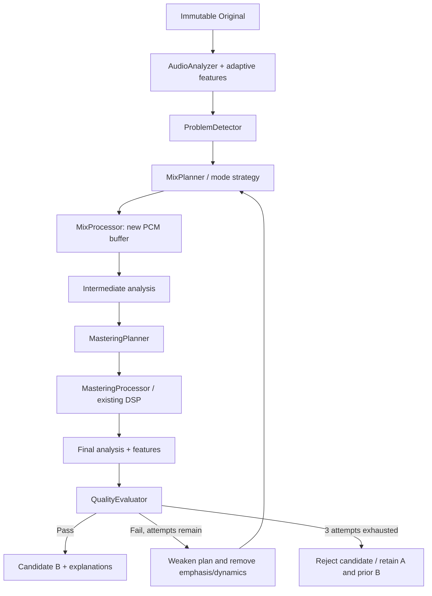

# Phase 6: Adaptive Automatic Mix & Master Engine

## Product flow

Import a song, press AUTO / IMPACT / LIVE, compare Original / Processed, then save
WAV if preferred. No EQ, threshold, release or LUFS knowledge is required. These
controls remain in the collapsed **Advanced Settings** for optional manual work.
The engine always starts from original A, including retries and mode switches.
Accepted candidates turn loudness match on automatically; RAW remains selectable.
Undo removes B and returns to A. Export never modifies A or includes listening gain.

Stages shown during processing: Analyzing, Creating candidate, Evaluating,
Finalizing. Plain-language explanations describe applied changes, without claims
of guaranteed professional quality. Advanced displays/downloads the complete plan,
intermediate/final measurements, attempt strengths and rejection reasons.

## Modules and ownership



- `audio-analysis/adaptive.ts`: broad band energy, 50 ms envelope distribution,
  L/R energy balance and negative-correlation window fraction.
- `core/auto/problem-detector.ts`: conservative problem flags.
- `core/auto/mix-planner.ts`: mode configuration + strategy produces typed stages.
- `core/auto/live-strategy.ts`: venue data and input-dependent live parameters.
- `dsp/mix.ts`: generic stage executor; no mode selection inside DSP.
- `dsp/live.ts`: dedicated room reflection/ambience processor, isolated from policy.
- `core/auto/mastering-planner.ts`: mastering settings derived from intermediate PCM measurements.
- `core/auto/quality-evaluator.ts`: comparison of original and candidate metrics.
- `core/auto/engine.ts`: bounded iteration and ownership/cancellation orchestration.

All numerical work runs in the processing Worker. UI only sends the mode and PCM,
displays returned evidence and uses existing comparison/export adapters. Core has
no DOM, filesystem, codec, paid service or network dependency. Original input is
never written by any stage; only owned mix candidate buffers are modified. The
master stage returns a further new buffer. Attempt history retains reports, not PCM.

This release works on mono/stereo rendered mixes. MixCorrectionPlan and generic
stages are separate from mastering, allowing future per-stem plans, but instrument
balance inside a stereo file cannot be independently corrected without separation.

## Input adaptation

Band ratios use overlapping one-pole split-filter energies, normalized by their
sum. They are broad descriptors, not calibrated spectral classification. Boundaries
are 180 / 700 / 2500 / min(6000, 0.4 × rate) Hz. Dense audio is crest <6 dB or
50 ms active-envelope P90/P10 range <2 dB; this is not LRA.

Examples of rules (all reductions scale down on retries):

| Detection | Mix correction |
| --- | --- |
| Bass ratio >0.55 | 120 Hz peaking cut, up to 2.4 dB |
| Low-mid >0.48 with bass >0.1 | 300 Hz cut, up to 1.8 dB |
| High-mid + air >0.5 | Broad 3800 Hz cut, up to 2 dB |
| Presence <0.1, without bass/air dominance | Up to 0.8 dB presence lift (AUTO/IMPACT) |
| DC magnitude >0.002 | Remove each channel mean |
| L/R difference >3 dB | Attenuate louder channel by up to 1.5 dB |
| Side energy >30% or unstable/negative correlation | Reduce side above 220 Hz; retain low side |
| Large envelope range >12 dB, not dense | Up to 1.2 dB linked gentle compression |

Thresholds are experimental project policy. They may mistake intentional tonal
choices for problems. Broad EQ is corrective; dynamic EQ/multiband compression,
de-clipping, stem separation and semantic vocal detection are not implemented.

**AUTO / NATURAL:** corrective stages only when flagged; no default width boost,
no punch stage. Natural loudness direction is -16 LUFS, preserving input already
between -18 and -14. A healthy input at target has no mix DSP and exact master bypass.

**IMPACT:** adds at most 1 dB envelope-derived transient emphasis and a small
presence lift only when input is not already dense/harsh. Modest upper-side widening
is allowed only when not already wide, sustained or strongly center-focused. The
loudness direction is -13 LUFS, but peak/reduction/crest gates override it. Density
is not created by clipping or unconditional heavy limiting.

**LIVE:** adaptive `small-hall` venue by default, with `intimate-room` retained for
space-risk material and external callers. The hall uses 24–28 ms predelay, four
weighted early reflections, normalized feedback delay lines, all-pass diffusion
and nominal decay of 1.1 s. Only the wet feed receives two 200–360 Hz high-pass
stages and damped high frequencies. Dry audio keeps its timing, level and channel count. Wet level
ducks during strong direct sound to prioritize foreground clarity. A final 80 ms
wet fade preserves original length without an abrupt cut to the added tail.
Conditional EQ, linked dynamics/transient and slight upper-side width complement
the space stage. Mono remains mono, rather than inventing a stereo signal.

Broad stereo content or unstable phase reduces wet level/decay. Confident Dry
temporal evidence overrides sustained-envelope risk; sustained notes alone cannot
identify reverb. Wet estimates choose a short room and reduce the addition;
bass-heavy input raises the wet high-pass; center/presence dominance lengthens
predelay and reduces wet amount. These are conservative *proxies*: the engine does
not know whether a track already has reverb or contains vocals. It must not claim
semantic detection of either. Future venues can extend data/strategy independently
of the reflection processor. See [LIVE depth](live-depth.md) for the 0.7.2 change.

## Mastering and iteration

After mix correction the candidate is measured again, then gain + linked limiter
are planned from that measurement. Maximum loudness lift from A is AUTO 4 LU,
IMPACT 6 LU, LIVE 3 LU. Attenuation is capped at 12 LU per initial plan. Actual
targets are input-relative and bounded, not guaranteed preset LUFS. Advanced
records desired/effective/achieved values. Already-safe near-zero gain is bypassed.

At most three sequential attempts: strength 1, 0.5, 0.25. Each starts from A.
Attempts 2/3 also remove positive EQ and the dynamics stage rather than applying
the previous output again. Only the final accepted attempt's changes are described.
If no candidate passes, no candidate PCM is exposed/exported and prior B remains.

## Quality gates

All Phase 1 metrics are remeasured: LUFS, estimated TP, RMS, crest, stereo
correlation, side energy, clipping, DC. Additional features are compared as well.

| Gate | Acceptance bound |
| --- | --- |
| Format/timing | Same frames, sample rate and channels as A |
| Validity | Finite available metrics/features; measurable LUFS/RMS |
| Peak | Estimated TP ≤-1 dBTP (+0.0001 dB rounding tolerance), zero clipped samples |
| LUFS and RMS change | ≤+6.5 dB/LU increase, ≤12.5 decrease from A |
| Limiter + static peak guard | ≤3 dB combined attenuation |
| Crest loss | ≤1.5 dB AUTO/LIVE; ≤2 dB IMPACT |
| Envelope-range loss | ≤2 dB (active-window P90/P10) |
| DC | ≤max(0.003, original magnitude +0.001) per channel |
| Correlation decrease | ≤0.06 AUTO/IMPACT; ≤0.12 LIVE |
| Negative-correlation windows | Increase ≤0.05 |
| Side energy | Increase ≤4 percentage points, LIVE ≤6; decrease ≤12 |
| L/R imbalance | Absolute difference increase ≤0.5 dB |
| Bass or harsh-band fraction | Increase ≤0.06 |
| Presence retention | ≥70% of original fraction if original >0.15 |

Silence, undefined loudness and input samples ≥full scale are rejected before
rendering; clipping repair is not assumed. Gates catch measured regressions, not
every audible defect or aesthetic loss. Inter-sample peak measurement remains the
existing experimental 4× estimator. Real-music listening and stronger independent
reference validation remain necessary.

## Performance and cancellation

One Worker/job at a time; switching mode terminates the previous job. Generation
IDs suppress stale results. Original and prior B remain available after cancel.
Browser cancellation kills the Worker immediately; Core AbortSignal checks operate
between synchronous stages and callback boundaries, not as a mid-loop scheduler.

Automatic input is limited to 96 MiB decoded PCM, matching the existing A+B 192 MiB
budget. Playback AudioBuffer caches are released when heavy processing begins and
recreated only when playing again. Worker input clone, mix candidate, final candidate,
retained A/B, analysis scratch and GC timing still raise total memory substantially.
Delay-line storage is bounded by sample rate/venue, not song duration; band analysis
has only short states and 50 ms block statistics. No candidate PCM history is kept.
This is bounded offline processing, not streaming/WASM or a low-memory guarantee.

## API

```js
import { autoMixMaster } from '@music-sync/core';
const result = autoMixMaster(original, 'LIVE', {
  maxIterations: 3,
  onProgress: ({ stage, iteration }) => console.log(stage, iteration),
});
if (result.status === 'accepted' && result.processed) {
  // Keep original; offer result.processed.audio as B.
} else {
  // Keep previous B; show result.reasons.
}
```

`planMixCorrection`, `detectProblems`, `analyzeAdaptiveFeatures` and
`evaluateAutoQuality` expose reusable planning/evaluation boundaries. The old
manual processAudio/masterAudio contracts and report schema remain unchanged.
New automatic plans/results are version 1 under package version 0.6.0.

## Phase 7 update

The Phase 6 description above records its original rules. Version 0.7.0 automatic
finishing uses [perceptual decisions](perceptual-intelligence.md) in place of the
old broad-band EQ/width/emphasis choices. Metering, mastering, Worker, ownership
and safety gates remain; new objective checks are additive. Dynamic EQ and selective
multiband are now implemented. Direct legacy four-argument planning stays compatible.
