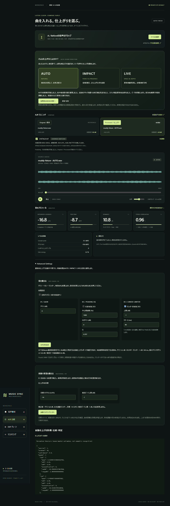
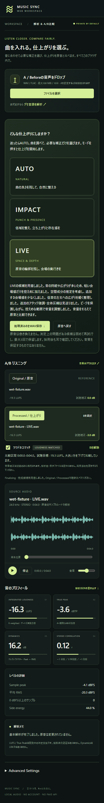
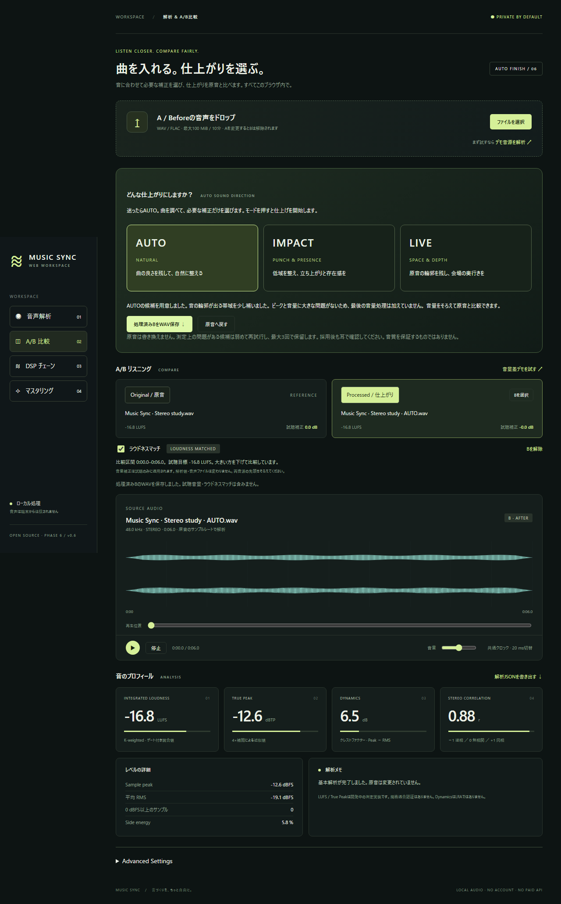
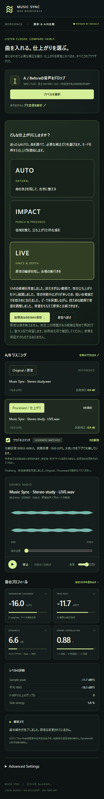
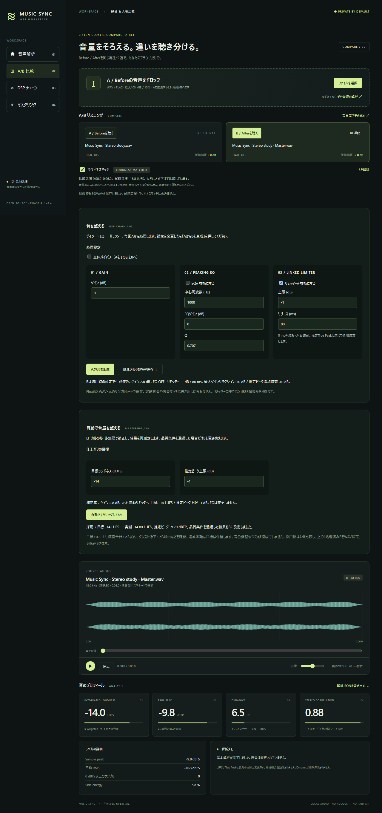
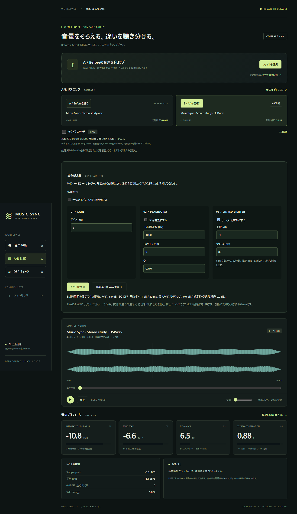
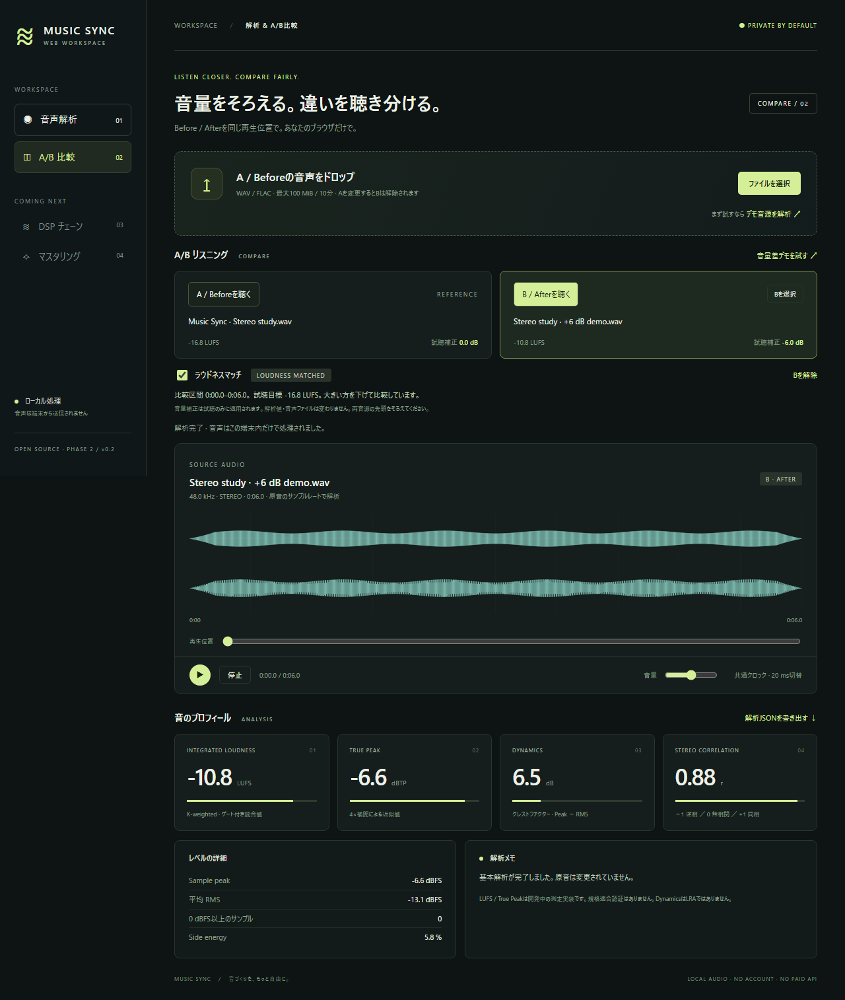
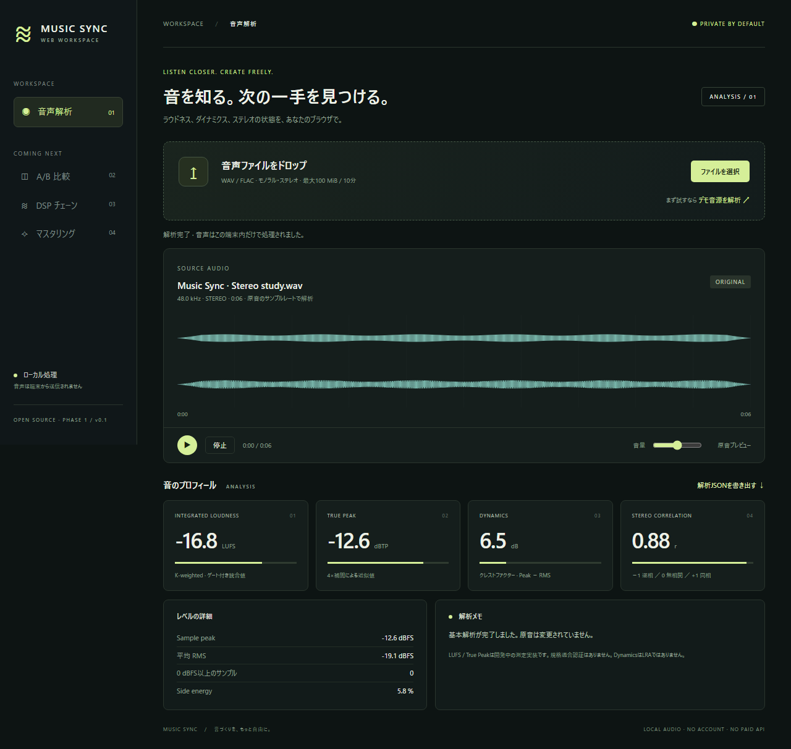

# Validation record

## Unreleased long-WAV analysis foundation — 2026-11-09

- On the K-drive development checkout, `npm run check` passed: lint, strict
  typecheck, **188 unit/reference tests**, build and eight Core examples.
- **51 Chromium E2E tests passed** on the final build. A generated 11-minute,
  8 kHz WAV was analyzed in bounded chunks, its Original was previewed, and
  long-file finishing controls were correctly disabled. Replacing it with a
  short WAV restored the normal finishing path.
- The first full browser run exposed an existing A/B error-message expectation;
  the new WAV preflight now retains the prior RIFF/WAVE error. A later full run
  exposed a timing race while importing: mode buttons still targeted the old A.
  They are now disabled during import, while mode switching during candidate
  processing remains available. Both cases and the full suite passed afterward.
- Streaming analyzer tests compare complete-song metrics and waveform against
  the existing whole-buffer analyzer across uneven chunk boundaries. WAV reader
  tests compare chunk decoding against the existing decoder and check cancellation.
- This validates chunked **analysis and Original preview**, not long-file AUTO,
  A/B, export, the maximum 20-minute case, mobile memory, real music quality,
  WebKit or Firefox. See [long-audio migration](long-audio.md).

## 0.13.0 adaptive pair correction and Worker recovery — 2026-10-04

- `npm run check` passed: lint, strict typecheck, **183 unit/reference tests**, Web
  and library builds, and all eight Core examples. New cases cover adaptive
  proposal, unnecessary EQ avoidance, post-filter acceptance/reversion, original
  PCM ownership, plan/descriptor mismatch and chunk cancellation.
- All **50 Chromium E2E cases passed**. Paired import measured and displayed the
  applied accompaniment correction. A new case simulated a temporary Worker
  manifest outage, retained both staged files, then retried successfully on the
  same page without file reselection. The 390 px screenshot was visually checked.
- Five 0.13.0 packages passed a fresh offline external install, public API,
  TypeScript and bundler checks. Direct ESM, module Worker and installed SDK
  passed in Chromium and WebKit.
- The preview service outage seen in the user's screenshot was reproduced as an
  unavailable `workers.json` request, then the local preview was restarted and
  both manifest and processing Worker returned HTTP 200. This establishes the
  cause of that error state; the actual private recordings were not loaded by the
  agent or used in test fixtures.
- The presence dip is a measured -1 to -2 dB candidate for user-labelled
  vocal/accompaniment pairs, not voice recognition or proof of subjective quality.
  Real long-song timing/memory, private-material audition and full-app Safari/
  Firefox remain unverified. The 96 MiB bus cap is unchanged.

## 0.12.0 adaptive vocal/accompaniment level — 2026-10-02

- `npm run check` passed after the final Core/UI changes: lint, strict
  typecheck, **177 unit/reference tests**, all package/Web builds and eight
  Core examples. Five new unit cases cover quiet/adequate/dominant pairs,
  source ownership, peak safety, manual gain bounds, invalid evidence and
  cancellation. The example shows a measured +3 dB vocal adjustment.
- All **49 Chromium E2E cases passed** for the 0.12.0 feature and previous
  workflow. After the final mobile label and applied-gain display changes,
  the new pair workflow was rerun on the final build and passed. It covers
  default automatic level, numeric report evidence, disabling the option,
  transactional rebuild and no horizontal overflow at 390 px.
- Five coordinated 0.12.0 packages passed fresh offline external installation,
  public exports, schema, ownership, TypeScript and installed bundling.
  Direct ESM, module Worker and installed SDK passed in Chromium and WebKit.
- `test-results/stem-auto-balance.png` was visually inspected with synthetic
  sources. It shows the active automatic option, plain-language decision and
  the applied vocal gain separately from the manual gain menu.
- This phase makes a conservative *level* decision for user-labelled vocal and
  accompaniment sources. It cannot recognize vocals, correct masking, replace
  source separation, or guarantee a subjectively better mix. Paired automatic
  input decodes each source twice to keep the sequential memory budget; real
  long-song processing time/memory, private STEM recordings, subjective listening
  and full-app Safari/Firefox remain unverified. The 96 MiB bus cap is unchanged.

## 0.11.1 import safety and report privacy — 2026-10-01

- `npm run check` passed: lint, strict typecheck, **172 unit/reference tests**,
  all package/Web builds and eight Core examples. The new unit cases cover
  negated vocal role names, Core STEM finishing safety, unused clipped tracks,
  anonymized report fields and original ownership.
- All **48 Chromium E2E cases passed**. Five new cases cover A/B and report
  retention after failed/cancelled imports, editable failed STEM staging,
  explicit vocal/instrumental targets, rapid queued additions and cancellation,
  capacity preflight without allocating decoded PCM, and anonymous/detailed
  report exports. The existing 43 cases also passed. A test expectation for
  the default anonymous report filename was updated; it was not an app failure.
- Five coordinated 0.11.1 packages passed a fresh offline external install,
  public exports, schema, ownership, strict TypeScript and installed bundling.
  Direct ESM, module Worker and installed SDK passed in Chromium and WebKit.
- `test-results/import-safety-pair.png` was visually inspected at a 390 px
  mobile viewport. Dedicated role targets, editable track rows and capacity
  guidance fit without horizontal overflow. The fixture is synthetic.
- A single-file import commits A or B only after successful decode and
  analysis. The source STEM list remains available for correction after a
  failed mix. The Core STEM finishing wrappers carry pre-mix clipping evidence
  into the quality decision. Downloaded reports are anonymous by default;
  a separate opt-in enables material names.
- The 96 MiB stereo Float32 bus limit remains. At 48 kHz this is 262.144 s
  (about 4 min 22 s), and at 96 kHz about 2 min 11 s, subject to other
  source limits. The UI now reports the computed project cap before PCM
  allocation, but chunked long-file processing has not been implemented.
  No subjective audio quality, real private STEM recordings, full-app
  Safari/Firefox or low-memory stress verification is claimed. See the
  [v0.11.0 review](reviews/2026-09-30-web-0.11-review.md) for the historical
  findings and remaining Desktop gaps.

## 0.11.0 STEM and vocal/instrumental import — 2026-09-30

- `npm run check` passed: lint, strict typecheck, **163 unit/reference tests**,
  library/Web builds and eight Core examples. The new tests cover synchronized
  summing, short-track silence padding, immutable source PCM, roles, level/mute/pan,
  sample-rate and memory preflight, source clipping, peak protection, and cancellation.
- All **43 Chromium E2E cases passed**. Six new cases exercise separate and
  multi-file drop, vocal/instrumental and general STEM modes, WAV/FLAC mixed import,
  AUTO processing and loudness-matched A/B, WAV/report export, rollback on malformed
  or mismatched input, clipping warnings, and cancellation during a 45-second WAV
  analysis. One existing screenshot test required a specific AUTO section selector
  after the new STEM section was added; app behavior was unchanged by that fix.
- Five coordinated 0.11.0 packages passed fresh offline external installation,
  Node public exports/schema/ownership, strict TypeScript and installed bundling.
  Direct ESM, module Worker and installed SDK passed in Chromium and WebKit using
  the existing browser cache. The screenshots `test-results/vocal-instrumental-input.png`
  and `test-results/stem-mobile.png` were visually inspected with synthetic audio;
  the mobile view had no horizontal overflow.
- Input starts at the same frame and sample rate; shorter tails are padded with
  silence. Automatic beat alignment, resampling, source separation and track-specific
  adaptive mixing are not implemented. FLAC decoding uses the browser's native API;
  an in-flight native decode may finish after cancellation, but its result is discarded.
  No subjective listening, real private STEM recording, full-app Safari/Firefox or
  low-memory long-file stress verification is claimed. See [STEM input](stem-input.md).

## 0.10.0 finishing preferences and destination mastering — 2026-09-29

- `npm run check` passed: lint, strict typecheck, **151 unit/reference tests**,
  library/Web builds and seven Core examples. Twenty-one preference tests cover
  zero/default compatibility, seven independent controls, source-dependent bounds,
  destination targets, combined LIVE/colour, radio/record/tape with final output,
  original ownership, clipping, bounded retries, cancellation and repeated switching.
- All **34 pre-existing Chromium E2E cases passed**, as did the three new preference
  cases after fixing their export verifier. The first full run passed 36/37; the
  failing new test assumed a 44-byte PCM header for Float32 WAV and failed to skip
  its `fact` chunk. The verifier now walks RIFF chunks; all three new cases passed
  on rerun (8.0 s). No app/export behavior was changed to satisfy that assertion.
  Lint and strict types passed again after the test fix.
- New browser checks cover combined controls, destination switching, final measured
  LUFS versus downloaded WAV PCM, matched A/B, cancellation with old B retained,
  settings reset without replacing B, honest limited targets and mobile layout.
  Screenshot `test-results/finishing-preferences.png` was visually inspected and
  uses a synthetic fixture, not a private recording.
- Five coordinated 0.10.0 packages passed fresh offline external installation,
  Node public exports/schema/ownership, strict TypeScript and installed bundling.
  Direct ESM, module Worker and installed SDK passed in Chromium and WebKit using
  the existing workspace cache. Full-app Safari/Firefox and long-file memory
  stress remain unverified.
- The in-app 0.10.0 screen visibly exposes all seven controls and five destinations.
  The user's previous Black Rose Original and arena LIVE candidate were retained
  in their existing 0.9.0 tab; no refresh, transfer or recording copy was performed.
  No subjective listening claim or platform/CD-format compliance is made.
  See [finishing preferences](finishing-preferences.md) for target provenance.

## 0.9.0 Venue LIVE — 2026-09-29

- `npm run check` passed: lint, strict typecheck, **130 unit/reference tests**,
  all library/Web builds and six Core examples. New venue tests cover three sample
  rates, reflection/tail energy, loudness-matched waveform change, level-relative
  ducking, bass protection, strength, invalid parameters, immutable Original,
  adaptive confidence and retry attenuation. These are objective measurements,
  not a guarantee of subjective musical improvement.
- All **34 Chromium E2E cases passed**, including the existing regression flows,
  three venue choices, strength switching, matched A/B, report/WAV export,
  cancellation with prior B retained and mobile layout. Screenshot:
  `test-results/live-venue-controls.png` uses a synthetic fixture.
- Five coordinated 0.9.0 packages passed a fresh offline external install,
  Node public exports/schema/ownership, strict TypeScript and installed bundle
  checks. Direct ESM, module Worker and installed SDK passed in Chromium and
  WebKit using the existing workspace browser cache. Full-app Safari/Firefox
  testing and long-file memory stress remain unverified.
- The user's already-imported 187.6-second, 48 kHz stereo song was reprocessed
  in its existing in-app tab without reload/re-import. The new default hall/vivid
  candidate passed the unchanged quality gates on its first attempt: **0 clipped
  samples, -3.50 dBTP estimate and -16.0 integrated LUFS**. Requested venue and
  strength were present in the report; loudness matching remained enabled.
  Original was retained, and no private recording was added to the repository,
  fixtures or packages. No listening preference was assessed.
- Legacy room algorithms remain available at the lower-level API. The named
  venue module uses bounded delay rings and owns a separate candidate buffer.
  See [Venue LIVE design](live-venues.md) for compatibility and scope.

## 0.8.0 sound colour choices — 2026-09-29

- `npm run check` passed: lint, typecheck, **122 unit/reference tests**,
  all library/Web builds and six examples. Nineteen new colour cases cover ten
  presets, three source rates, strength/response, deterministic texture, silent
  input, original ownership, peak protection, malformed settings, gates,
  cancellation, switching and AUTO integration.
- The full **32 Chromium E2E cases passed**. After final API inventory/metadata
  updates, the three sound-colour browser cases passed again, including report/WAV
  downloads, matched comparison, cancellation and mobile layout. Screenshot:
  `test-results/sound-color-presets.png` (synthetic fixture, not the user's song).
- Five 0.8.0 tarballs passed a fresh offline external install, Node public API/
  ownership/schema checks, strict TypeScript and installed-package bundling.
  The expected public export inventory was extended for the new APIs; unchanged
  schema and deep-import restrictions remain tested.
- SDK ESM/Worker and installed bundle passed Chromium and WebKit, including
  the new colour API in the installed consumer. The first WebKit launch used the
  default cache where its executable was absent; rerunning with
  `PLAYWRIGHT_BROWSERS_PATH` pointing at the existing workspace browser cache
  passed both engines. No browser download was needed. This is not full-app
  WebKit/Safari verification.
- A fresh in-app tab visibly shows the new selector and version 0.8.0. The prior
  user's audio tab was not refreshed or replaced. No private recording was added
  to tests/packages, and subjective listening preference is not claimed.

## 0.7.2 clearer LIVE depth — 2026-09-29

- `npm run check` passed: lint, strict typecheck, **103 unit/reference tests**,
  library/Web builds and examples. Eight new LIVE tests cover tail energy at three
  sample rates, dry timing/ownership, bass attenuation, venue limits, adaptive
  selection, sustained Dry evidence and loudness-matched waveform difference.
- All **29 Chromium browser cases verified**. The first full run passed 27 and
  exposed two incorrect test expectations (export filename and demo's adaptive
  venue). Both were corrected to the existing behavior; all four tests in their
  two files then passed. Runtime/export behavior was not altered to satisfy them.
- Five coordinated 0.7.2 packages passed external offline Node/TypeScript/bundler
  installation. Direct ESM, module Worker and installed SDK checks passed in
  Chromium and WebKit.
- The user's already-imported 241.76-second, 48 kHz stereo song was processed in
  its existing in-app tab, without refresh/re-import. The first small-hall candidate
  (wet 0.28 / nominal decay 1.1 s) passed unchanged quality gates: 0 clipped samples,
  -4.44 dBTP estimate and -16.0 integrated LUFS. Matched A/B remained available.
  No user recording was saved in fixtures or packages; subjective preference was
  not assessed. Original and previous B were retained until the new candidate was
  accepted. See [LIVE depth](live-depth.md) for design and boundaries.

## 0.7.1 Worker deployment hotfix — 2026-09-29

- Reproduced the affected already-open in-app tab: its old processing Worker URL
  returned HTTP 200 `text/html` SPA fallback after a rebuild. DSP had not started.
- Restored AUTO processing in that same tab without refreshing or re-importing
  Original. A candidate appeared and matched comparison/export became available.
  No recording was copied into the repository; no listening preference is claimed.
- Lint, typecheck, all **95 unit tests**, builds and examples passed.
- All **28 Chromium browser tests passed** (50.8 s): the previous 23 plus changed
  deployment assets, HTML/protocol rejection with prior B retained, cancellation
  during metadata loading, compatibility-entry PCM queue and analysis error wording.
- Five 0.7.1 packages passed external offline Node/TypeScript/bundler installation.
  Chromium/WebKit direct ESM, Worker and installed SDK checks passed.
- DSP/analysis algorithms and input limits are unchanged. See
  [Worker deployment design and hosting boundaries](worker-deployment.md).

## Phase 7 / v0.7.0 perceptual intelligence — 2026-09-29

- Final `npm run check`: lint, strict types, **95 unit/reference tests**, library
  and Web builds and all five Node examples passed. All previous 70 tests remain.
- Final `npm run test:e2e`: **23 Chromium tests passed** in 45.7 seconds,
  retaining all previous 21 workflows. Added checks cover chosen/skipped decisions,
  valid perceptual/objective JSON download, and wet-fixture LIVE on mobile.
- New unit coverage includes all eight bands with inverse-phase stereo, arbitrary
  chunk boundaries, level-invariant spectral descriptors, mud/harsh/dull/bass/bright
  discrimination, confidence restraint, persistent/intermittent plans, selective
  multiband selection, stereo/mono protection, wet/dry counterexamples, strong attack
  restraint, Dynamic EQ threshold behavior, complementary multiband bypass, objective
  improvement, ownership, retries/cancel/determinism and blind matching preparation.
- `npm run test:package`: five local tarballs passed independent offline Node /
  TypeScript / bundler tests, including new public exports and chunk analysis.
  `npm run test:sdk-browser`: direct ESM, module Worker and installed-bundle checks
  passed in Chromium and WebKit, including version-1 perceptual/objective results.
- `npm run evaluate:perceptual`: 13 original synthetic arrangements produced complete
  before/after evidence. All obtained safe final candidates; dullness lift was omitted
  on retry when its objective improvement was unproven. This does **not** imply all
  perceived defects were fixed. See [fixture evidence](evaluation/phase7-fixtures.json).
- Desktop Advanced and mobile screenshots were inspected; the main mode controls
  remain simple and the mobile page has no horizontal overflow.
- A 180-second 44.1 kHz stereo synthetic input, 60.56 MiB PCM, completed LIVE in
  **18.36 seconds**, one accepted attempt, on this Windows/Node 24.13 machine.
  Process RSS snapshots: **104.57 MiB before / 231.83 MiB after**. They are not peak
  memory or browser measurements. The earlier Phase 6 observation was 17.34 seconds;
  these separate runs are not a controlled performance comparison.
- New spectral state is fixed-size FFT/histogram storage (under 256 KiB of numeric
  arrays per analyzer); no per-song spectral frame history. Whole-candidate DSP
  remains offline and the 96 MiB automatic input limit is unchanged.

Unverified: licensed diverse-music/blind listening, calibrated confidence accuracy,
full metering conformance, low-memory phones, Firefox and actual Safari. Coarse
high-rate low-frequency resolution, rare transient detection and ambience ambiguity
remain limitations. End-to-end streaming DSP and a completed blind UI are future
work. No hosted publication or remote CI execution is claimed.

See [design, thresholds and APIs](perceptual-intelligence.md) and
[Phase 7 implementation report](phase7-report.md).

## Phase 6 / v0.6.0 adaptive finishing — 2026-09-27

- `npm run check`: lint, strict typecheck, **70 unit/reference tests**, production
  build and five Node examples all passed.
- `npm run test:e2e`: **21 Chromium Web tests passed** (43.3 seconds), including
  all previous workflows, one-click AUTO, LIVE mobile layout, matched A/B, export,
  undo, rapid mode switching, cancellation and rejection without replacing A.
- Unit coverage includes analysis-dependent plans, all three modes, unnecessary
  DSP omission and exact healthy-AUTO bypass, Original ownership, clipping gates,
  LIVE impulse responses at 8/48/192 kHz, bounded retries, cancellation, mode
  isolation and decoded-memory limits. Existing loudness-matching tests also pass.
- `npm run test:package`: five local tarballs passed allowlists/checksums, offline
  independent installation, Node API/ownership tests, strict TypeScript contracts
  and browser bundling. `npm run test:sdk-browser` passed direct ESM, module Worker
  and installed bundle checks in **Chromium and WebKit**, including automatic LIVE.
- Desktop and 390px mobile screenshots were inspected. Normal finishing does not
  require opening Advanced Settings. No horizontal mobile overflow was observed.
- A 180-second 44.1 kHz stereo synthetic input (60.56 MiB Float32 PCM) completed
  LIVE in 17.34 seconds with one accepted attempt in Node 24.13 on this Windows
  machine. Process RSS was 107.98 MiB before and 234.56 MiB after; these are
  snapshots, **not peak memory**, browser measurements or a hardware benchmark.
- Legacy source manifest: all 98 recorded files remain unchanged. The impact.67
  archive was inspected statically; the desktop GUI was not regression-tested.

Limits: broad feature heuristics are experimental, not vocal/reverb recognition;
true peak uses the existing estimator. Real-music listening, full meter conformance,
low-memory phones, Firefox and actual Safari remain unverified. Dynamic EQ,
multiband dynamics, stems and streaming processing are not implemented. The
96 MiB decoded-input limit bounds allocation but does not guarantee low total RAM.
No public registry/hosting deployment or remote CI run is claimed.

See [design and acceptance bounds](auto-finishing.md) and
[Windows reference review](phase6-reference-review.md).

## Phase 5 / v0.5.0 local SDK — 2026-09-27

- Lint, strict types, all 57 unit/reference tests, package/Web builds and four Node
  consumer examples passed. Schema/algorithm/chain versions remain unchanged.
- All 18 existing Web Chromium flow tests passed in 34.5 seconds.
- Five npm tarballs passed file allowlist and required-file checks. Checksums are
  verified before installing into an independent temporary project, with a fresh
  empty npm cache, offline mode and install scripts disabled. All five packages
  are real local installs rather than workspace symlinks.
- Installed Core passed Node public-export, report/chain version, analysis,
  mastering, WAV, source ownership and blocked-deep-import assertions. Strict
  TypeScript consumer compilation includes negative type-contract checks.
- A browser bundler resolves the installed tarballs from that external project.
  Chromium and WebKit passed its gain/WAV checks and the separate direct ESM +
  module Worker mastering example, with no page errors or external requests.
- Firefox 155 downloaded but did not complete browser startup in this Windows
  execution environment; its attempt was interrupted before SDK execution. No
  Firefox success is claimed. WebKit checks are not Safari device certification
  or coverage of all Web app codec/playback behavior.
- Original desktop: all 98 recorded source hashes unchanged before packaging.
- Registry/GitHub publication, owner/scope/URL metadata and hosted CI execution
  remain pending. Local pack/release scripts perform no publishing or upload.

## Phase 4 / v0.4.0 — 2026-09-27

- Lint, strict types, 57 unit/reference tests, production build and four built-Core
  Node consumers passed on Windows (Node 24.13.0 / npm 11.6.2).
- All 18 Chromium browser tests passed in 34.2 seconds, including Phase 1–3 flows.
- Mastering tests cover quiet/loud sources, bit-exact no-op, silence, short clips,
  clipping, extreme required gain, DC before/after processing, transient-heavy
  rejection, unreachable target/ceiling, deterministic output and invalid options.
- Known stereo tones retain correlation/crest and frame count. Original PCM and
  options remain unchanged. Rejected candidates expose no output PCM.
- Browser tests cover visible proposals, accepted output and export, rejection
  retaining prior B, cancellation, invalid settings, source replacement and mobile.
- Desktop/390px mobile screenshots inspected; no horizontal overflow. Demo flow
  emits no external requests or page errors.
- Legacy source hashes verified for all 98 recorded files before packaging.
- No subjective music listening, full metering certification, long-file memory
  stress, Firefox/Safari or hosted GitHub Actions execution is claimed.

## Phase 3 / v0.3.0 — finalized 2026-09-27

- Lint, strict types, 48 unit/reference tests, production build and three Node Core
  consumer examples passed during implementation on 2026-09-22.
- All 15 Chromium browser tests passed, including the Phase 1/2 regression flows;
  rerun on 2026-09-27 passed in 32.1 seconds after restarting the local preview.
- Added exact bypass/unity, EQ center response at five sample rates, extreme
  parameter impulse decay, linked stereo ratios, impulse timing, estimated peak
  ceilings, silence, deterministic output, invalid parameters and WAV roundtrip.
- Browser tests verify generated B, unchanged A, cancellation, repeated rendering
  from A, export independent of monitoring gains, and native Float32 WAV decoding.
- Desktop and 390px mobile screenshots inspected. No horizontal mobile overflow.
- Legacy source integrity checked against the 98-file manifest before packaging.
- No subjective musical listening, long-file memory stress, Firefox/Safari or
  hosted CI verification is claimed. Limiter is experimental; see processing.md.

## Phase 2 / v0.2.0 — 2026-09-22

- Lint, strict types, 36 unit/reference tests, production build and both built-Core
  Node examples passed on Windows with Node 24.13.0 / npm 11.6.2.
- All 12 Chromium browser tests passed (14.0 seconds), including the original
  Phase 1 flows, two-file comparison, shared seek/pause, invalid/cancelled B,
  unequal duration, undefined loudness and mobile layout.
- Actual OfflineAudioContext output verifies sample-aligned impulses after seek
  and switches, 6.02 dB RAW difference versus matched difference within 0.1 dB
  for known tones, and continuous bounded ramps under rapid switching.
- Original PCM remains unchanged in Core and rendered-player tests. Legacy source
  hashes: all 98 recorded files unchanged.
- Desktop and 390px mobile screenshots inspected. Tests are objective/synthetic;
  subjective listening and Firefox/Safari remain unverified.
- Windows browser-test lifecycle now owns Node servers directly and tears down
  only its own processes. No new runtime dependencies were introduced.

## Phase 1 baseline

Verified locally on 2026-09-22, Windows, Node 24.13.0 / npm 11.6.2.

| Check | Result |
| --- | --- |
| ESLint + TypeScript strict typecheck | Pass |
| Unit/reference tests | 28 passed |
| Built packages + Vite production app | Pass |
| Node example using built Core exports | Pass |
| Chromium 153 browser tests | 5 passed (final run 4.8 seconds) |
| WAV import (8/16/24/32-bit, Float32), stereo/source rate | Covered by unit/browser tests |
| Real synthesized FLAC import | Pass, original 44.1 kHz |
| File drop, cancellation, invalid file/replacement | Pass |
| Original playback controls and JSON download | Pass; no subjective listening assessment |
| Desktop and 390px mobile layout | Screenshots inspected; no horizontal mobile overflow |
| External page requests in demo flow | None observed |
| npm audit | 0 reported vulnerabilities on this date |
| Legacy source integrity | All 98 recorded files unchanged |
| Legacy executable provenance | ZIP executable matches recovered dist_impact67 executable |

Reference LUFS comparisons use independent pyloudnorm DeMan values at 44.1, 48 and
96 kHz, three frequencies each, tolerance 0.01 LU. Tests also cover stereo energy
summation, inverse phase, silence, short clips, gates, DC offsets, sample clipping,
intersample peaks and invalid samples. They do not replace a full ITU/EBU suite.

The first Windows Playwright run completed all assertions but its npm-wrapped
preview server delayed teardown. The preview command now calls Vite directly;
the final run used the separately running local preview and exited successfully.
The app's browser behavior passed in both runs.

Not verified: Firefox/Safari, exhaustive codec compatibility, low-memory phones,
10-minute stress tests, full metering conformance, desktop GUI/regression execution,
source-to-binary reproducible desktop build, hosted GitHub Actions, public hosting.
The workflow is configured but no remote CI run or deployment has occurred.

Public registry publication remains pending; Phase 5 local SDK validation is recorded above.

